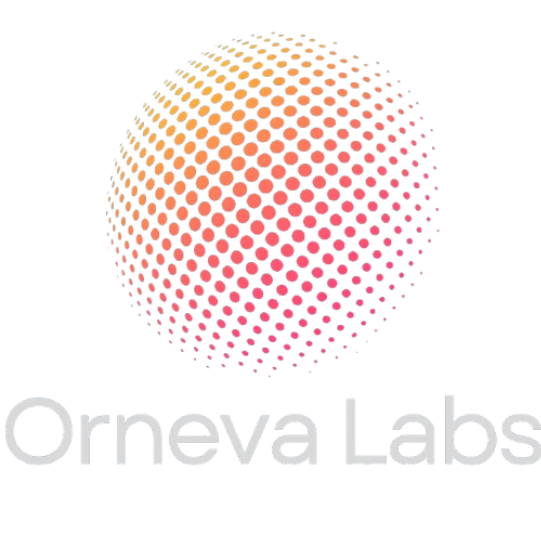

# Orneva Labs

> **"The Origin of New Possibilities"**  
> *"Learn something useful. Build something real."*



Orneva Labs is a premium, student-focused micro-learning platform offering short, practical, and highly affordable courses across modern **Artificial Intelligence**, **productivity systems**, **visual design**, **modern technology**, and **startup MVP prototyping**.

Instead of long, theoretical 40-hour lecture marathons that leave students with zero portfolio proof, Orneva Labs operates on an intensive **"Learn → Build → Prove"** sprint framework: each micro-course equips learners with concrete mental models and guided workflows to build and deploy a live, tangible project in 2 to 5 hours.

---

## 🌟 Key Features & Platform Capabilities

### 1. Public Student Portal & Website
- **Landing Page (`index.html`)**: Ambient glow aesthetic, brand hero, live statistics counters, value propositions, interactive visual windows, dynamic featured courses, student testimonials, and FAQ accordion.
- **Course Catalog (`courses.html`)**: Dynamic course loading from database, real-time instant search, category filters (AI, Productivity, Design, Startup), difficulty filters, and smart sorting (price, duration, title).
- **Course Detail Sprints (`course.html?slug=...`)**: Dynamic slug-based routing, outcome checklists, prerequisite requirements, curriculum accordion, capstone deliverable project highlight, and lifetime enrollment card.
- **About & Philosophy (`about.html`)**: Company mission, vision, the "Learn → Build → Prove" operating model, core values, and founder vision by Rohit Badgujar.
- **Student Authentication (`login.html`)**: Dual-mode Sign In and Registration with instant client session validation and redirect handling.
- **Student Dashboard (`dashboard.html`)**: Personalized learning hub displaying enrolled courses, payment status pills, interactive module completion checkboxes, and dynamic progress bar tracking.
- **Checkout & Payment Flow (`payment.html`)**: Secure course checkout, student intake form, unique transaction reference generation, dynamic UPI QR code generator, and payment proof/UTR submission form.
- **Payment Lifecycle States**:
  - `payment-pending.html`: Real-time transaction lookup, clear 3-step verification progress timeline, and one-click WhatsApp confirmation link.
  - `payment-success.html`: Instant celebration screen confirming verified enrollment and unlocking dashboard access.
  - `payment-failed.html`: Direct assistance screen with automated WhatsApp dispute resolution link.
- **404 Error Page (`404.html`)**: Custom branded page not found screen.

### 2. Administrative Console (`admin.html` & `admin-login.html`)
- **Admin Authentication**: Dedicated access gateway (`/admin-login.html`) with session authorization guards.
- **Live Business Overview & Stats**: Real-time KPI cards for total courses, registered students, active enrollments, pending payments, verified payments, and verified total revenue (calculated strictly from confirmed payments).
- **Course Management (CRUD)**: Create new courses, edit titles/prices/descriptions/tools/outcomes, structure curriculum phases, and toggle publish states without editing frontend code.
- **Payment Verification Desk**: Review incoming payments, inspect 12-digit UPI UTR numbers and uploaded payment screenshot proofs, approve with one click (which automatically activates enrollment), or reject with custom audit notes.
- **Student Directory**: Search and monitor registered students, their contact details, and their active enrollment counts.
- **Enrollment Management**: Complete record of all course enrollments and their live status (`ACTIVE`, `PENDING_APPROVAL`, `REJECTED`).
- **System Settings**: Live configuration management for Payee UPI ID, Payee Name, WhatsApp support phone, platform status, and global announcements.
- **Audit Logs**: Immutable operational log capturing all administrative actions, course modifications, payment submissions, and authentications.

---

## 💳 UPI Payment Architecture

Orneva Labs implements a transparent, authentic Indian UPI payment flow:

- **Official UPI ID**: `9172750062@fam`
- **Payee Name**: `Orneva Labs`
- **Support WhatsApp**: `+91 9172750062`

```
Course Page
    ↓
Click "Enroll Now"
    ↓
Student Details Entry (Name, Email, WhatsApp Phone)
    ↓
Unique Transaction ID Generated (ORN-YYYYMMDD-XXXXXX)
    ↓
Dynamic UPI QR Code Rendered & UPI URI App Intent Created
    ↓
Student Scans QR & Pays via GPay / PhonePe / Paytm / BHIM
    ↓
Student Enters 12-Digit UPI UTR Reference & Uploads Screenshot Proof
    ↓
Status Recorded as PENDING (Duplicate Txn/UTR submission strictly blocked)
    ↓
Admin Reviews Proof in Admin Console (/admin.html)
    ↓
Admin Verifies Payment
    ↓
Payment Marked as VERIFIED → Enrollment Automatically Activated as ACTIVE
    ↓
Course Modules & Deliverable Briefs Unlocked in Student Dashboard
```

> **Security & Price Enforcement**: The backend retrieves and validates the authoritative course tuition fee from the database. Client-submitted prices are never trusted.

---

## 📚 Flagship Micro-Sprints

The platform launches pre-seeded with five core courses:

| # | Course Title | Category | Duration | Price | Capstone Deliverable |
|---|--------------|----------|----------|-------|----------------------|
| 1 | **Build Your First AI App** | AI | 3.5 Hours | ₹499 | Deploy an interactive AI Academic Research Assistant with streaming responses live on Vercel. |
| 2 | **ChatGPT Mastery for Students** | AI | 2.0 Hours | ₹299 | Construct a complete personal Academic Copilot with 12 production-grade prompt templates. |
| 3 | **Canva to Creator** | Design | 2.5 Hours | ₹349 | Design and publish a complete 10-slide startup pitch deck and creator brand identity kit. |
| 4 | **AI Productivity System** | Productivity | 3.0 Hours | ₹399 | Build an operational Notion Second Brain workspace powered by PARA and automated briefing. |
| 5 | **Build Your First Startup MVP** | Startup | 5.0 Hours | ₹699 | Launch a functional MVP landing page with payment collection and live user tracking in 1 weekend. |

---

## 🏗️ Architecture & Technology Stack

- **Frontend Core**: Pure Semantic HTML5 and Vanilla ECMAScript (ES6+) for ultra-fast load times and zero dependency bloat.
- **Design System & Styling**: Custom Vanilla CSS with Design Tokens (`css/style.css`, `css/responsive.css`, `css/admin.css`).
  - Google Font: **Montserrat**
  - Theme: Deep near-black background (`#07080a`), glassmorphic panels (`rgba(16, 19, 26, 0.75)` with `backdrop-filter: blur(16px)`), curated burnt orange accents (`#ff5722`), and crisp white/grey typography.
- **Backend API Layer**:
  1. **Google Apps Script REST API (`backend/Code.gs`)**: Serverless cloud API handling GET/POST dispatchers for courses, students, payments, progress, and settings.
  2. **Google Sheets Database**: Relational multi-sheet database containing 8 schemas: `Courses`, `Students`, `Payments`, `Enrollments`, `Progress`, `Logs`, `Settings`, `Admins`.
  3. **Universal Edge Fail-Safe Engine (`js/api.js`)**: Real-time client-side database simulation that ensures instantaneous local testing, offline caching, and zero downtime even before cloud deployment.

---

## 🔒 Security Best Practices

1. **No Hardcoded Passwords**: Plaintext credentials are eliminated from frontend code and version control.
2. **Salted Cryptographic Hashing**: Student and administrator passwords are validated using SHA-256 salted hashes.
3. **Server-Side Price Validation**: Course tuition fees are re-checked against the database record before registering payments.
4. **Duplicate Prevention**: Unique transaction IDs (`ORN-YYYYMMDD-XXXXXX`) and UTR reference codes prevent replay submissions.
5. **Role-Based Guards**: Administrative API endpoints and pages require valid session authentication tokens.
6. **XSS Protection**: HTML escaping utilities (`escapeHtml`) are applied on all dynamically rendered user inputs.

---

## 🚀 Setup & Deployment

### Quick Local Run
Simply open `index.html` in any modern web browser or run a lightweight local static server:
```bash
# Using Python
python -m http.server 8000

# Using Node.js
npx serve .
```

### Production Google Sheets & Apps Script Deployment
1. Create a new Google Spreadsheet at [sheets.new](https://sheets.new) and name it **"Orneva Labs Production Database"**.
2. Go to **Extensions** → **Apps Script**.
3. Replace the contents of `Code.gs` with the entire contents of [`backend/Code.gs`](backend/Code.gs).
4. Run the function `setupOrnevaDatabase()` once to automatically create all 8 sheets, headers, and seed courses.
5. Click **Deploy** → **New deployment** → Type: **Web app**:
   - Execute as: `Me`
   - Who has access: `Anyone`
6. Copy the resulting Web App URL and paste it into `CONFIG.API_URL` in [`js/utils.js`](js/utils.js).

For detailed setup instructions, consult [`backend/README_DEPLOYMENT.md`](backend/README_DEPLOYMENT.md).

---

## 🧪 Automated QA & Integration Testing

The repository contains an automated test suite validating the entire full-stack integration:

```bash
node test-qa-suite.js
```

The suite validates:
- Static brand assets and file existence (`logo.png`, `founder.png`, course thumbnails)
- HTML structure, page titles, and meta descriptions across all 13 pages
- Unique transaction ID generation and format validation
- UPI payment URI scheme and WhatsApp link generation
- Cryptographic SHA-256 password hashing
- Course retrieval, category filtering, search queries, and slug routing
- Student registration, duplicate prevention, and login validation
- UPI payment submission, PENDING status recording, and duplicate rejection
- Server-side price enforcement (tamper resistance)
- Admin authentication, payment verification, and enrollment activation
- Interactive module completion and course progress calculation
- Verified revenue calculation (ignoring pending/rejected transactions)
- Complete administrative Course CRUD operations
- System audit logging

---

## 📄 License & Rights

&copy; 2026 **Orneva Labs**. All rights reserved.  
Crafted for builders, creators, and future founders.
